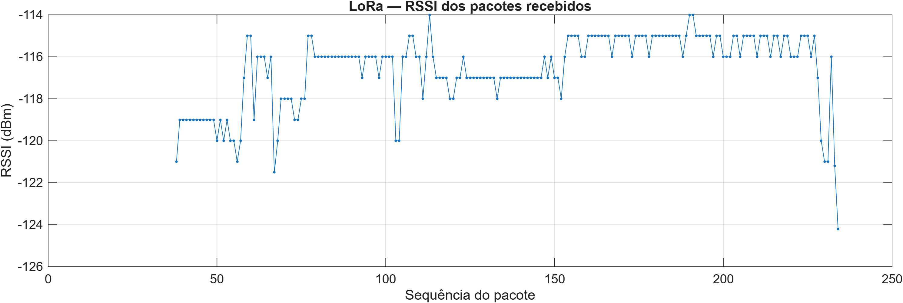
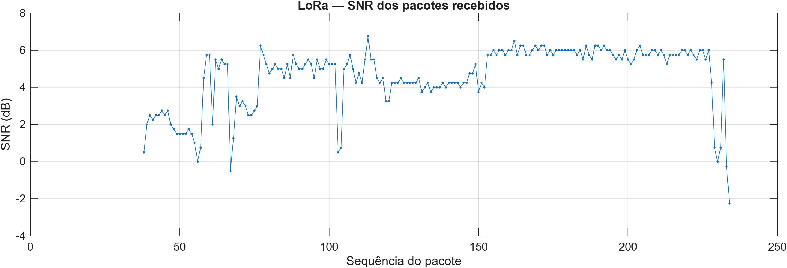

# LoRa Link Analyzer

Projeto de estudo e portfólio para desenvolver um analisador de enlace LoRa utilizando **STM32 com Rust embarcado**, **ESP32 com C/ESP-IDF** e **Python para coleta e armazenamento dos resultados**, com **MATLAB Online para análise estatística e gráficos**.

## Objetivo

Transmitir pacotes de teste entre dois rádios LoRa e avaliar a comunicação por meio de:

- RSSI e SNR;
- pacotes únicos recebidos;
- lacunas de sequência;
- pacotes duplicados ou fora de ordem;
- taxa de entrega observada no receptor;
- confirmações de recebimento;
- timeouts e retransmissões;
- análise estatística e gráficos no MATLAB Online;
- latência/RTT, em uma etapa futura.

O ESP32 funciona como gateway conectado ao computador por USB. A STM32 atua como nó remoto, transmite os pacotes de teste e aguarda confirmações.

## Arquitetura

| Parte | Hardware | Software | Função |
| --- | --- | --- | --- |
| Nó remoto | STM32 Nucleo-F446RE + SX1278 | Rust embarcado | Transmitir pacotes, receber ACKs e realizar reenvios |
| Base | ESP32 + SX1278 | C com ESP-IDF | Receber pacotes, responder ACKs e emitir métricas pela USB |
| Computador | PC conectado à base por USB | Python com pySerial | Ler os dados estruturados e salvar arquivos CSV |
| Análise | Navegador no computador | MATLAB Online | Importar CSVs, calcular estatísticas e gerar gráficos |

Os dois módulos utilizam o SX1278 e operam em **433 MHz**. A comunicação é **LoRa ponto a ponto**, sem LoRaWAN.

## Estado atual

Atualizado em **09/10/2026**.

Estão funcionando e validados em bancada:

- comunicação bidirecional STM32 ↔ ESP32;
- confirmação de recebimento por ACK;
- timeout de espera pelo ACK;
- até três tentativas por pacote;
- tratamento de duplicatas no ESP32;
- recuperação após desligar e religar o gateway;
- emissão de dados estruturados pela serial;
- coleta em Python e armazenamento em CSV;
- importação dos dados no MATLAB Online;
- estatísticas de RSSI e SNR;
- gráficos de RSSI e SNR por sequência;
- conferência de sequências distintas, duplicatas e ausências no intervalo observado;
- exportação dos gráficos em PNG e registro dos resultados no GitHub.

A primeira coleta salva contém **83 registros**. Em **09/10/2026**, uma nova sessão gerou **199 registros**, analisados no MATLAB Online. O próximo passo é reunir os comandos em um script `analise_lora.m` para repetir a análise nas próximas coletas.

## Protocolo atual

### Pacote de dados

A STM32 transmite uma mensagem de 24 bytes:

```text
SEQ=00012;MSG=STM32-LORA
```

### Confirmação

O ESP32 responde com uma mensagem de 9 bytes:

```text
ACK=00012
```

O terminador de string não é transmitido.

### Fluxo de comunicação

1. A STM32 gera um pacote com número sequencial.
2. O rádio transmite e sinaliza `TxDone`.
3. A STM32 entra em recepção para aguardar o ACK.
4. O ESP32 recebe e valida os dados.
5. O ESP32 transmite o ACK correspondente e retorna à recepção.
6. A STM32 verifica CRC, tamanho, conteúdo e sequência da resposta.
7. Se o ACK for válido, avança para o próximo pacote.
8. Se houver timeout, reenvia a mesma sequência.
9. Após três tentativas sem confirmação, registra o resultado e segue para o próximo pacote.

O limite é de **três tentativas totais: um envio inicial e até dois reenvios**.

Uma duplicata recebida pelo ESP32 é confirmada novamente, mas não é contabilizada como uma nova entrega única.

> `TxDone` confirma apenas que o rádio concluiu a transmissão local. A ausência de ACK pode representar perda dos dados ou perda da resposta.

## Parâmetros atuais

| Parâmetro | Valor |
| --- | --- |
| Frequência | 433 MHz |
| Bandwidth | 125 kHz |
| Spreading Factor | SF7 |
| Coding Rate | 4/5 |
| Preâmbulo | 8 símbolos |
| Header | Explícito |
| CRC | Ativado |
| Sync Word | `0x12` |
| Potência configurada nos rádios | Aproximadamente 12 dBm, usando PA_BOOST |
| Tentativas por pacote | Até 3 |
| Espera pelo ACK na STM32 | Cerca de 1,5 s, mais processamento |
| Pausa adicional antes de reenvio | 200 ms |
| Espera do ESP32 antes de transmitir ACK | Pelo menos 50 ms |
| Pausa após finalizar um pacote | 2 s |

A espera pelo ACK utiliza 1.500 sondagens com atraso de 1 ms. Não é uma medição precisa de latência.

O período entre pacotes inclui transmissão, espera pelo ACK, possíveis reenvios e a pausa final. Nas primeiras linhas da coleta CSV, o intervalo observado foi próximo de **2,17 s**, com confirmação normal.

## Métricas

### STM32

| Contador | Significado |
| --- | --- |
| Pacotes finalizados | Pacotes que receberam ACK ou esgotaram as tentativas |
| Confirmados | Pacotes com ACK válido |
| Sem confirmação | Pacotes que esgotaram as três tentativas |
| Reenvios | Tentativas adicionais à primeira |
| TX OK | Transmissões locais concluídas, incluindo reenvios |
| Falhas TX | Tentativas sem confirmação de `TxDone` |
| Timeouts ACK | Tentativas com TX concluído, mas sem ACK válido na janela |
| RX rejeitados | Recepções que não passaram pela validação do ACK |

Exemplo observado:

```text
Transmitindo pacote: 215; tentativa: 1/3
ACK confirmado. Pacote: 215
Pacotes finalizados: 215; confirmados: 214; sem confirmacao: 1; reenvios: 5
TX OK: 220; falhas TX: 0; timeouts ACK: 6; RX rejeitados: 2
```

Esse acumulado é um registro funcional da sessão. Não representa, sozinho, uma caracterização da confiabilidade do enlace.

### ESP32

O gateway registra:

- sequência recebida;
- tamanho do pacote;
- RSSI e SNR;
- pacotes únicos recebidos;
- lacunas entre sequências;
- duplicatas;
- pacotes fora de ordem;
- taxa de entrega calculada a partir dos contadores do receptor.

A taxa exibida utiliza:

```text
taxa de entrega = recebidos / (recebidos + lacunas) × 100
```

O contador atualmente exibido como “Pacotes perdidos” representa lacunas inferidas entre sequências recebidas.

## Testes realizados

| Teste | Resultado observado |
| --- | --- |
| Salto proposital de sequência | ESP32 identificou a lacuna e atualizou as métricas |
| Comunicação com ACK | STM32 recebeu confirmações das sequências enviadas |
| ESP32 desligado | STM32 registrou timeouts e continuou executando |
| Limite de tentativas | Mesma sequência transmitida até três vezes antes de avançar |
| ESP32 religado | Confirmações retornaram sem reiniciar a STM32 |
| Omissão controlada do primeiro ACK | STM32 reenviou e recebeu confirmação na segunda tentativa |
| Tratamento de duplicatas | ESP32 incrementou duplicatas sem aumentar entregas únicas |
| Primeira coleta serial em Python | Arquivo CSV salvo com 83 registros em 07/09/2026 |
| Nova coleta serial em Python | Arquivo CSV salvo com 199 registros em 09/10/2026 |
| Análise no MATLAB Online | Estatísticas, gráficos e conferência de sequências realizados |
| Exportação e versionamento | Gráficos PNG exportados e registrados no GitHub |

### Teste controlado de perda de ACK

O firmware ESP32 possui a opção:

```c
#define TEST_DROP_FIRST_ACK 0
```

Com valor `1`, o gateway omite o ACK da primeira recepção de cada nova sequência. Os dados continuam sendo contabilizados.

No reenvio, o ESP32 identifica a duplicata e responde com ACK.

Exemplo observado na STM32:

```text
Transmitindo pacote: 4; tentativa: 1/3
Timeout ACK. Pacote: 4
Transmitindo pacote: 4; tentativa: 2/3
ACK confirmado. Pacote: 4
```

No ESP32, o reenvio da sequência 12 manteve os recebidos em 12 e aumentou as duplicatas de 11 para 12.

**Após o teste, a opção foi restaurada para `0` e o funcionamento normal foi confirmado.**

## Dados estruturados pela serial

Além dos logs, o ESP32 emite uma linha por recepção válida:

```text
LORA_DATA,3,24,-114.0,7.50,0,3,0,0,0
```

| Posição | Campo |
| --- | --- |
| 1 | Identificador `LORA_DATA` |
| 2 | Sequência |
| 3 | Tamanho em bytes |
| 4 | RSSI em dBm |
| 5 | SNR em dB |
| 6 | Indicador de duplicata: `0` ou `1` |
| 7 | Total de pacotes únicos recebidos |
| 8 | Total de lacunas de sequência |
| 9 | Total de duplicatas |
| 10 | Total fora de ordem |

Duplicatas também geram linhas, permitindo preservar o histórico das recepções.

## Coletor Python

O arquivo `pc-analysis/collector.py`:

- abre a serial do ESP32;
- filtra linhas iniciadas por `LORA_DATA`;
- valida campos e valores;
- preserva fragmentos até completar uma linha;
- acrescenta o horário UTC de processamento no computador;
- grava um CSV novo por execução;
- permite encerrar com `Ctrl + C`.

### Preparação

No Ubuntu/WSL:

```bash
cd ~/projetos/Projeto-Lora-Stm/pc-analysis

python3 -m venv .venv
source .venv/bin/activate

python -m pip install -r requirements.txt
```

### Execução

Com as duas placas ligadas, a STM32 transmitindo e o USB do ESP32 disponível no WSL:

```bash
cd ~/projetos/Projeto-Lora-Stm/pc-analysis
source .venv/bin/activate
python collector.py
```

A configuração atual utiliza `/dev/ttyUSB0` e 115200 baud.

**Encerre o monitor do ESP-IDF antes de iniciar o coletor**, pois os dois programas utilizam a mesma porta serial.

Fechar o monitor no computador não interrompe o firmware do ESP32.

### Primeira coleta

Arquivo salvo:

```text
pc-analysis/data/lora_20260907_141447_038149.csv
```

Total informado ao encerrar: **83 registros**.

Exemplo do conteúdo:

```csv
pc_received_at_utc,sequence,payload_bytes,rssi_dbm,snr_db,is_duplicate,received_unique,sequence_gaps,duplicates_total,out_of_order_total
2026-09-07T14:14:47.711+00:00,156,24,-111.0,8.0,0,1,0,0,0
2026-09-07T14:14:49.881+00:00,157,24,-114.0,7.25,0,2,0,0,0
2026-09-07T14:14:52.051+00:00,158,24,-114.0,7.0,0,3,0,0,0
```

A sequência pode começar acima de 1 porque a STM32 já estava transmitindo antes da coleta.

O horário registrado corresponde ao processamento da linha pelo Python. **Não é o instante exato da recepção LoRa nem uma medição de latência.**

## Análise no MATLAB Online — 09/10/2026

A coleta serial continua sendo feita pelo Python. O MATLAB Online recebe o CSV após o término da sessão e realiza a análise; nesta etapa, não existe conexão direta entre o MATLAB Online e os rádios.

### Arquivos da sessão

- [CSV da coleta](pc-analysis/data/lora_20261009_212758_442277.csv)
- [Gráfico de RSSI](pc-analysis/results/20261009/rssi_20261009.png)
- [Gráfico de SNR](pc-analysis/results/20261009/snr_20261009.png)

O nome do CSV utiliza o horário UTC. As estatísticas abaixo foram calculadas sobre os **199 registros**, incluindo as duas duplicatas.

### Resultados

| Métrica | Resultado |
| --- | --- |
| Registros no CSV | 199 |
| Sequências distintas | 197 |
| Registros marcados como duplicatas | 2 |
| Primeira sequência registrada | 38 |
| Última sequência registrada | 234 |
| Sequências esperadas no intervalo inclusivo | 197 |
| Sequências ausentes nesse intervalo | 0 |
| Taxa de recepção observada no intervalo | 100% |
| Média dos valores de RSSI em dBm | −116,5774 dBm |
| RSSI mínimo | −124,20 dBm |
| RSSI máximo | −114,00 dBm |
| SNR médio | 4,5942 dB |
| SNR mínimo | −2,25 dB |
| SNR máximo | 6,75 dB |

A taxa foi calculada por:

```text
sequências distintas / (última sequência − primeira sequência + 1) × 100
197 / (234 − 38 + 1) × 100 = 100%
```

Todas as sequências de 38 a 234 foram registradas pelo menos uma vez. Isso inclui possíveis reenvios e **não significa sucesso de todas as primeiras tentativas ou de todos os ACKs**. A conta pressupõe que a numeração não reiniciou durante a coleta e não contempla perdas antes da primeira sequência ou depois da última.

As duas duplicatas são compatíveis com o mecanismo de reenvio, mas o CSV do receptor não determina sozinho a causa de cada repetição.

### Gráficos





RSSI e SNR aumentaram na parte intermediária da coleta e caíram no final. Apesar da queda, nenhuma sequência ficou ausente no intervalo observado. A causa da variação não foi determinada nesta sessão.

Os pontos representam recepções registradas, incluindo duplicatas. As linhas conectam esses pontos e não representam medições de pacotes ausentes.

### Repetir a análise

Envie o CSV ao MATLAB Drive e selecione sua pasta no MATLAB Online. Na Command Window:

```matlab
dados = readtable("lora_20261009_212758_442277.csv");

registros = height(dados)
duplicatas = sum(dados.is_duplicate)
sequencias = unique(dados.sequence);
sequencias_distintas = numel(sequencias)

primeira = min(sequencias)
ultima = max(sequencias)
esperados = ultima - primeira + 1
ausentes = esperados - sequencias_distintas
taxa_observada = 100 * sequencias_distintas / esperados

rssi_medio = mean(dados.rssi_dbm)
rssi_minimo = min(dados.rssi_dbm)
rssi_maximo = max(dados.rssi_dbm)

snr_medio = mean(dados.snr_db)
snr_minimo = min(dados.snr_db)
snr_maximo = max(dados.snr_db)
```

Para criar e exportar os gráficos, mantenha uma referência explícita a cada figura:

```matlab
fig_rssi = figure;
plot(dados.sequence, dados.rssi_dbm, ".-");
grid on
xlabel("Sequência do pacote");
ylabel("RSSI (dBm)");
title("LoRa — RSSI dos pacotes recebidos");
drawnow
exportgraphics(fig_rssi, "rssi_20261009.png", "Resolution", 300);

fig_snr = figure;
plot(dados.sequence, dados.snr_db, ".-");
grid on
xlabel("Sequência do pacote");
ylabel("SNR (dB)");
title("LoRa — SNR dos pacotes recebidos");
drawnow
exportgraphics(fig_snr, "snr_20261009.png", "Resolution", 300);
```

Baixe os PNGs pelo MATLAB Drive e confira as imagens antes de substituir os arquivos em `pc-analysis/results/20261009/`. Para outra sessão, ajuste os nomes do CSV, dos gráficos e da pasta de resultados.

Os comandos foram executados interativamente. O script reutilizável `analise_lora.m` ainda não foi criado.

## Limitações atuais

- O sistema foi desenvolvido para um transmissor e um gateway.
- Ainda não existe identificador explícito de sessão.
- Os contadores reiniciam com o respectivo microcontrolador.
- O ESP32 usa o retorno à sequência 1, após uma sequência maior, como indício de reinício.
- A STM32 encerra o ensaio na sequência 99999 para evitar reutilizar números durante a execução.
- O tratamento de duplicatas atende aos reenvios consecutivos do protocolo atual.
- Lacunas não detectam perdas anteriores à primeira sequência recebida nem posteriores à última.
- O CSV representa as recepções do ESP32; não informa sozinho quantos ACKs chegaram à STM32.
- O contador de recepções rejeitadas na STM32 ainda não separa os motivos de rejeição.
- A análise no MATLAB foi executada interativamente; ainda não foi consolidada em um script reutilizável.
- Ainda não foram implementadas medição de RTT, integração dos contadores da STM32 ao CSV ou comparação sistemática de alcance.
- Os valores de RSSI e SNR são os informados pelo firmware, sem calibração independente nesta sessão.

## Progresso

### Concluído

- [x] Preparação do Rust e do alvo `thumbv7em-none-eabihf`.
- [x] Configuração do `probe-rs`, ST-LINK e logs RTT.
- [x] Compilação e gravação da Nucleo-F446RE.
- [x] Validação inicial com LED e SysTick.
- [x] Ajustes de linker e memória.
- [x] Preparação do gateway com ESP-IDF.
- [x] Comunicação SPI e leitura de `RegVersion = 0x12` nas duas placas.
- [x] Configuração compatível dos rádios em 433 MHz.
- [x] Comunicação LoRa STM32 → ESP32.
- [x] Pacotes com número sequencial.
- [x] Métricas de RSSI, SNR, recebidos, lacunas e duplicatas.
- [x] Cálculo da taxa de entrega observada.
- [x] Comunicação bidirecional e ACK.
- [x] Timeout de espera pelo ACK.
- [x] Retransmissão com até três tentativas.
- [x] Confirmação de duplicatas sem duplicar entregas.
- [x] Testes de desligamento e recuperação.
- [x] Teste controlado de omissão de ACK.
- [x] Saída serial estruturada.
- [x] Coletor Python com pySerial.
- [x] Primeira coleta CSV com 83 registros.
- [x] Nova coleta CSV com 199 registros em 09/10/2026.
- [x] Importação e análise inicial no MATLAB Online.
- [x] Mínimo, média e máximo de RSSI e SNR.
- [x] Conferência de sequências distintas, duplicatas e ausências no intervalo observado.
- [x] Gráficos de RSSI e SNR por sequência.
- [x] Exportação dos gráficos em PNG e registro no GitHub.

### Próximos passos

- [ ] Criar `pc-analysis/matlab/analise_lora.m` com os comandos já utilizados.
- [ ] Permitir selecionar diferentes CSVs e gerar um resumo automaticamente.
- [ ] Analisar duração da coleta e intervalos entre registros.
- [ ] Definir sessões de teste com início e término controlados.
- [ ] Medir tempo de ida e volta (RTT).
- [ ] Integrar resultados do transmissor à análise no computador.
- [ ] Comparar testes variando distância, obstáculos e parâmetros LoRa.
- [ ] Documentar resultados dos ensaios controlados.
- [ ] Avaliar posteriormente uma análise equivalente em Python com `pc-analysis/analyze.py`.

## Marcos do projeto

| Etapa | Situação |
| --- | --- |
| STM32 executando Rust e ESP32 executando C/ESP-IDF | Concluída |
| Comunicação local ESP32 + SX1278 | Concluída em 02/09/2026 |
| Comunicação local STM32 + SX1278 | Concluída |
| Primeira comunicação LoRa STM32 → ESP32 | Concluída em 05/09/2026 |
| Sequências e métricas iniciais | Concluída em 05/09/2026 |
| ACK, timeout e comunicação bidirecional | Validados em 07/09/2026 |
| Retransmissões, duplicatas e recuperação | Validadas em 07/09/2026 |
| Coleta Python e armazenamento CSV | Validados em 07/09/2026 |
| Análise estatística e gráficos no MATLAB Online | Realizados em 09/10/2026 |
| Script MATLAB reutilizável | Próxima etapa |

## Estrutura do repositório

| Caminho | Conteúdo |
| --- | --- |
| `stm32-blink/stm32-blink/` | Firmware STM32 em Rust |
| `esp32-hello/` | Exemplo inicial de validação do ESP32 |
| `esp32-gateway/` | Gateway LoRa com ACK, métricas e saída estruturada |
| `pc-analysis/collector.py` | Coletor serial |
| `pc-analysis/requirements.txt` | Dependências Python |
| `pc-analysis/data/` | Coletas CSV |
| `pc-analysis/results/20261009/` | Gráficos PNG da sessão de 09/10/2026 |
| `README.md` | Documentação geral |

A pasta dupla `stm32-blink/stm32-blink/` corresponde à estrutura atual do projeto.

## Conexões STM32 — SX1278

| SX1278 | STM32 Nucleo-F446RE |
| --- | --- |
| VCC | 3V3 |
| GND | GND |
| SCK | D13 / PA5 |
| MISO | D12 / PA6 |
| MOSI | D11 / PA7 |
| NSS | D10 / PB6 |
| RESET | D9 / PC7 |
| DIO0 | D2 / PA10 |

Foi utilizado um capacitor de **10 µF** entre 3V3 e GND, próximo ao módulo LoRa.

> PA5 também está conectado ao LED verde LD2 da Nucleo. Durante a comunicação SPI, é utilizado como SCK.

## Conexões ESP32 — SX1278

| SX1278 | ESP32 |
| --- | --- |
| VCC | 3V3 |
| GND | GND |
| SCK | GPIO18 |
| MISO | GPIO19 |
| MOSI | GPIO23 |
| NSS | GPIO5 |
| RESET | GPIO14 |
| DIO0 | GPIO26 |

## Firmware STM32

O firmware utiliza `stm32f4xx-hal 0.23.0`, SPI1, clock interno HSI, temporização via SysTick e logs RTT com `defmt`.

No Ubuntu/WSL:

```bash
cd ~/projetos/Projeto-Lora-Stm/stm32-blink/stm32-blink
cargo build
cargo run
```

A Nucleo deve estar conectada pela USB do ST-LINK e disponibilizada ao WSL. O comando `cargo run` compila, grava e executa o firmware usando `probe-rs`.

| Arquivo | Finalidade |
| --- | --- |
| `Cargo.toml` | Dependências e perfis de compilação |
| `.cargo/config.toml` | Alvo ARM, linker e comando de gravação |
| `memory.x` | Mapa de memória |
| `build.rs` | Disponibilização do mapa de memória ao linker |
| `src/main.rs` | Transmissão, recepção de ACK e reenvios |

## Firmware ESP32

O projeto utiliza C com ESP-IDF. O rádio permanece em recepção, alterna para transmitir ACKs e retorna à recepção.

No Ubuntu/WSL, em um terminal preparado para ESP-IDF:

```bash
cd ~/projetos/Projeto-Lora-Stm/esp32-gateway
source ~/esp/esp-idf/export.sh
idf.py build
idf.py -p /dev/ttyUSB0 flash monitor
```

Na primeira configuração de uma nova cópia do projeto:

```bash
idf.py set-target esp32
```

Para encerrar o monitor serial, pressione **Ctrl + ]**.

## USB e porta serial no WSL

As placas precisam estar disponibilizadas ao WSL por USB.

O ESP32 utiliza um conversor CP210x na montagem atual. O ST-LINK corresponde à conexão de programação e depuração da STM32.

Se a porta desaparecer após desconectar a placa, verifique o compartilhamento USB e anexe novamente o dispositivo ao WSL.

Se o coletor indicar porta ocupada, verifique:

```bash
sudo fuser -v /dev/ttyUSB0
```

Encerre o monitor serial ou outro coletor que estiver utilizando a porta antes de iniciar uma nova coleta.

## Ambiente validado

| Ferramenta | Versão |
| --- | --- |
| Rust | 1.98.0 |
| Cargo | 1.98.0 |
| probe-rs | 0.32.0 |
| ESP-IDF | 6.0.1 |
| stm32f4xx-hal | 0.23.0 |
| Dependências Python | Registradas em `pc-analysis/requirements.txt` |

O desenvolvimento e os testes são realizados no Ubuntu/WSL.

Repositório de trabalho:

```text
~/projetos/Projeto-Lora-Stm
```

As pastas `target/`, `build/` e `managed_components/`, assim como ambientes virtuais e caches, permanecem fora do versionamento conforme o `.gitignore`.

## Aprendizados envolvidos

- Rust embarcado e desenvolvimento `no_std`;
- C com ESP-IDF;
- GPIO, SPI e temporização;
- registradores e FIFO do SX1278;
- eventos `TxDone` e `RxDone`;
- alternância entre transmissão e recepção;
- rádio LoRa ponto a ponto;
- RSSI, SNR e sequências de pacotes;
- ACK, timeout e retransmissão limitada;
- tratamento de duplicatas;
- testes com falhas controladas;
- depuração de USB e serial no WSL;
- ambientes virtuais Python;
- leitura serial, validação de dados e armazenamento CSV;
- tabelas e acesso a colunas no MATLAB;
- estatísticas com `mean`, `min` e `max`;
- contagem de sequências com `unique` e `numel`;
- gráficos e exportação de figuras;
- interpretação de métricas dentro do intervalo de observação.

## Autor

Guilherme Costa
