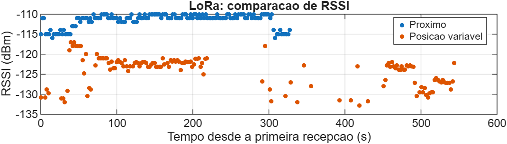
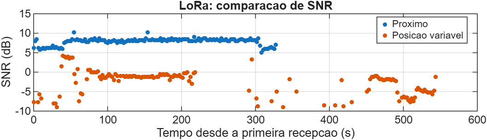

# LoRa Link Analyzer

Projeto de estudo e portfólio que integra **STM32 com Rust embarcado**, **ESP32 com C/ESP-IDF**, **Python para coleta serial** e **MATLAB Online para análise dos resultados**.

**Versão inicial concluída em 10/10/2026.**

## Objetivo

Transmitir pacotes sequenciais entre dois rádios LoRa e avaliar a comunicação por meio de RSSI, SNR, confirmações, retransmissões, duplicatas e lacunas de sequência.

O projeto utiliza **LoRa ponto a ponto em 433 MHz**, sem LoRaWAN.

## Arquitetura

| Parte | Hardware | Software | Função |
| --- | --- | --- | --- |
| Nó remoto | STM32 Nucleo-F446RE + SX1278 | Rust embarcado | Transmitir pacotes, receber ACKs e realizar reenvios |
| Base | ESP32 + SX1278 | C com ESP-IDF | Receber pacotes, responder ACKs e emitir métricas pela USB |
| Computador | PC conectado à base por USB | Python com pySerial | Salvar as recepções em CSV |
| Análise | MATLAB Online | Script MATLAB | Calcular métricas, comparar sessões e exportar gráficos |

A STM32 também foi testada alimentada por power bank, enquanto o ESP32 permaneceu conectado ao computador para coleta.

## Funcionalidades concluídas

- Comunicação SPI e identificação dos rádios.
- Comunicação LoRa bidirecional.
- Pacotes com número sequencial.
- Confirmação por ACK.
- Timeout e até três tentativas totais por pacote.
- Tratamento de duplicatas no receptor.
- Recuperação após desligar e religar o gateway.
- Teste controlado de omissão de ACK.
- Saída serial estruturada.
- Coleta Python com armazenamento em CSV.
- Análise inicial e comparação de sessões no MATLAB Online.
- Exportação de gráficos e tabela de resultados.

## Protocolo

Mensagem de dados: **24 bytes**.

```text
SEQ=00012;MSG=STM32-LORA
```

Confirmação: **9 bytes**.

```text
ACK=00012
```

O terminador de string não é transmitido.

### Fluxo

1. A STM32 transmite uma sequência e aguarda o ACK.
2. O ESP32 recebe os dados, registra as métricas e responde.
3. A STM32 valida a resposta e avança para o próximo pacote.
4. Se ocorrer timeout, retransmite a mesma sequência.
5. Após três tentativas sem confirmação, registra o resultado e avança.

O limite corresponde a **um envio inicial e até dois reenvios**.

Duplicatas são confirmadas novamente pelo ESP32, sem aumentar o contador de pacotes únicos.

> `TxDone` indica conclusão da transmissão local. Um timeout de ACK pode ocorrer por perda dos dados ou da resposta; não comprova sozinho perda do pacote no receptor.

## Parâmetros utilizados

| Parâmetro | Valor |
| --- | --- |
| Frequência | 433 MHz |
| Bandwidth | 125 kHz |
| Spreading Factor | SF7 |
| Coding Rate | 4/5 |
| Preâmbulo | 8 símbolos |
| Header | Explícito |
| CRC | Ativado |
| Sync Word | `0x12` |
| Potência configurada | Aproximadamente 12 dBm, usando PA_BOOST |
| Tentativas por pacote | Até 3 |
| Espera pelo ACK na STM32 | Cerca de 1,5 s, mais processamento |
| Pausa adicional antes de reenvio | 200 ms |
| Espera do ESP32 antes do ACK | Pelo menos 50 ms |
| Pausa após finalizar um pacote | 2 s |

O período entre pacotes inclui transmissão, confirmação e possíveis reenvios. Com confirmação normal, foi observado um intervalo próximo de **2,17 s**.

## Testes funcionais

| Teste | Resultado |
| --- | --- |
| Salto proposital de sequência | Lacuna identificada pelo ESP32 |
| Comunicação com ACK | Confirmações recebidas pela STM32 |
| Gateway desligado | Timeouts registrados sem interromper o transmissor |
| Limite de tentativas | Até três transmissões antes de avançar |
| Gateway religado | Confirmações retomadas |
| Omissão controlada do primeiro ACK | Reenvio e confirmação na segunda tentativa |
| Pacote duplicado | Nova confirmação sem duplicar a entrega única |
| STM32 no power bank | Transmissão mantida sem computador conectado |

O teste de omissão de ACK utiliza:

```c
#define TEST_DROP_FIRST_ACK 0
```

Com valor `1`, o primeiro ACK de cada nova sequência é omitido. Após a validação, a opção foi restaurada para `0`.

## Coleta serial em Python

O ESP32 emite uma linha por recepção válida:

```text
LORA_DATA,3,24,-114.0,7.50,0,3,0,0,0
```

Os campos são:

| Campo | Significado |
| --- | --- |
| `sequence` | Número do pacote |
| `payload_bytes` | Tamanho recebido |
| `rssi_dbm` | RSSI informado pelo firmware |
| `snr_db` | SNR informado pelo firmware |
| `is_duplicate` | Indicador de duplicata |
| `received_unique` | Contador de pacotes únicos |
| `sequence_gaps` | Contador de lacunas de sequência |
| `duplicates_total` | Contador de duplicatas |
| `out_of_order_total` | Contador de pacotes fora de ordem |

O coletor acrescenta `pc_received_at_utc`, com o horário de processamento da linha no computador, e gera um CSV novo por execução.

**Esse horário não representa o instante exato da recepção pelo rádio e não mede latência.**

### Preparação no WSL

```bash
cd ~/projetos/Projeto-Lora-Stm/pc-analysis
python3 -m venv .venv
source .venv/bin/activate
python -m pip install -r requirements.txt
```

### Execução

```bash
cd ~/projetos/Projeto-Lora-Stm/pc-analysis
source .venv/bin/activate
python collector.py
```

Configuração utilizada: `/dev/ttyUSB0`, 115200 baud.

Encerre o monitor do ESP-IDF com **Ctrl + ]** antes de iniciar o coletor. Para finalizar a coleta, pressione **Ctrl + C**.

## Histórico das coletas

| Sessão | Registros | Observação |
| --- | ---: | --- |
| 07/09/2026 | 83 | Primeira coleta CSV |
| 09/10/2026 | 199 | Primeira análise no MATLAB Online |
| 10/10/2026 — próximo | 152 | Referência com placas próximas |
| 10/10/2026 — posição variável | 153 | Deslocamentos entre locais e cômodos |

### Análise de 09/10/2026

Foram registradas 197 sequências distintas, de 38 a 234, sem sequências ausentes nesse intervalo e com duas duplicatas.

As médias calculadas sobre os 199 registros, incluindo duplicatas, foram:

- RSSI: **−116,5774 dBm**.
- SNR: **4,5942 dB**.

Arquivos:

- [CSV](pc-analysis/data/lora_20261009_212758_442277.csv)
- [RSSI](pc-analysis/results/20261009/rssi_20261009.png)
- [SNR](pc-analysis/results/20261009/snr_20261009.png)

## Validação final — 10/10/2026

Foram comparadas duas sessões com os mesmos parâmetros LoRa.

### Condições

**Próximo:** STM32 e ESP32 próximos, com a STM32 alimentada pelo power bank e o ESP32 conectado ao computador.

**Posição variável:** tentativa inicial no fundo da residência, a aproximadamente 35 metros, seguida de aproximações, afastamentos e mudanças de cômodo. Foi relatada ausência de recepção na posição inicial. A sessão registrada contém várias posições e obstáculos, sem distância fixa.

A segunda sessão é um ensaio exploratório de variação do enlace, não uma medição controlada de alcance máximo.

### Resultados

| Métrica | Próximo | Posição variável |
| --- | ---: | ---: |
| Recepções registradas | 152 | 153 |
| Pacotes únicos | 152 | 146 |
| Duplicatas | 0 | 7 |
| Primeira sequência | 69 | 6 |
| Última sequência | 220 | 169 |
| Sequências esperadas no intervalo | 152 | 164 |
| Sequências ausentes no intervalo | 0 | 18 |
| Recepção no intervalo observado | 100% | 89,02% |
| Média dos valores de RSSI em dBm | −111,51 | −124,26 |
| SNR médio em dB | 7,8816 | −2,5394 |
| Duração entre primeira e última recepção | 327,68 s | 546,19 s |
| Maior intervalo entre registros de recepção | 2,174 s | 72,537 s |

RSSI e SNR foram calculados usando somente a primeira recepção de cada sequência.

A taxa de recepção utiliza:

```text
pacotes únicos / (última sequência − primeira sequência + 1) × 100
```

Essa conta pressupõe ausência de reinício ou reutilização das sequências durante cada sessão. Não inclui perdas anteriores ao primeiro pacote recebido ou posteriores ao último, nem representa sucesso das primeiras tentativas ou dos ACKs.

### Gráficos





Cada sessão utiliza seu próprio tempo relativo, começando na primeira recepção registrada. Os pontos representam a primeira recepção de cada sequência. Não há medições de RSSI ou SNR para pacotes ausentes.

### Interpretação

Na condição próxima, todas as sequências do intervalo observado foram recebidas, sem duplicatas, com intervalos regulares.

Na sessão com mudanças de posição, o RSSI médio ficou aproximadamente 12,75 dB menor. Foram observadas lacunas, duplicatas e um intervalo de 72,537 segundos entre registros consecutivos de recepção.

As duplicatas são compatíveis com retransmissões, mas os registros da base não determinam sozinhos o motivo de cada repetição.

Os resultados demonstram o funcionamento da coleta e da análise em condições diferentes. Não permitem determinar o alcance máximo nem atribuir as variações exclusivamente à distância, pois posição, obstáculos e orientação da montagem não foram controlados separadamente.

### Arquivos

- [CSV próximo](pc-analysis/data/lora_20261010_172641_082828.csv)
- [CSV com posição variável](pc-analysis/data/lora_20261010_173747_456161.csv)
- [Script de comparação](pc-analysis/matlab/comparar_sessoes.m)
- [Resumo CSV](pc-analysis/results/resumo_20261010.csv)

## Reproduzir a comparação no MATLAB Online

1. Envie os dois CSVs de 10/10/2026 e `comparar_sessoes.m` ao MATLAB Drive.
2. Coloque os três arquivos na mesma pasta.
3. Selecione essa pasta como pasta atual do MATLAB.
4. Abra o script e clique em **Run**.

O script calcula o resumo, verifica a ordem das sequências distintas e exporta:

```text
resumo_20261010.csv
comparacao_rssi_20261010.png
comparacao_snr_20261010.png
```

O resumo e os gráficos são gravados na pasta atual do MATLAB. Para analisar outras sessões, altere os nomes de entrada e de saída no script.

## Conexões STM32 — SX1278

| SX1278 | STM32 Nucleo-F446RE |
| --- | --- |
| VCC | 3V3 |
| GND | GND |
| SCK | D13 / PA5 |
| MISO | D12 / PA6 |
| MOSI | D11 / PA7 |
| NSS | D10 / PB6 |
| RESET | D9 / PC7 |
| DIO0 | D2 / PA10 |

Foi utilizado um capacitor de **10 µF** entre 3V3 e GND, próximo ao rádio.

PA5 também está conectado ao LED LD2 da Nucleo e é utilizado como SCK neste projeto.

## Conexões ESP32 — SX1278

| SX1278 | ESP32 |
| --- | --- |
| VCC | 3V3 |
| GND | GND |
| SCK | GPIO18 |
| MISO | GPIO19 |
| MOSI | GPIO23 |
| NSS | GPIO5 |
| RESET | GPIO14 |
| DIO0 | GPIO26 |

## Compilação e gravação

### STM32 — Rust

O firmware utiliza `stm32f4xx-hal 0.23.0`, SPI1, HSI, SysTick e logs RTT com `defmt`.

```bash
cd ~/projetos/Projeto-Lora-Stm/stm32-blink/stm32-blink
cargo build
cargo run
```

A USB do ST-LINK deve estar disponível no WSL. `cargo run` compila, grava e executa usando `probe-rs`.

Os logs RTT de depuração são distintos da medição de tempo de ida e volta do enlace, que não foi implementada.

### ESP32 — C/ESP-IDF

```bash
cd ~/projetos/Projeto-Lora-Stm/esp32-gateway
source ~/esp/esp-idf/export.sh
idf.py build
idf.py -p /dev/ttyUSB0 flash monitor
```

Na primeira configuração de uma nova cópia:

```bash
idf.py set-target esp32
```

Para sair do monitor: **Ctrl + ]**.

### Porta serial no WSL

Se a porta estiver ocupada:

```bash
sudo fuser -v /dev/ttyUSB0
```

Encerre o programa que utiliza a serial antes de abrir outro. Após desconectar uma placa, pode ser necessário anexar novamente seu dispositivo USB ao WSL.

## Estrutura do repositório

| Caminho | Conteúdo |
| --- | --- |
| `stm32-blink/stm32-blink/` | Firmware STM32 |
| `esp32-hello/` | Validação inicial do ESP32 |
| `esp32-gateway/` | Gateway LoRa |
| `pc-analysis/collector.py` | Coletor serial |
| `pc-analysis/requirements.txt` | Dependências Python |
| `pc-analysis/data/` | Coletas CSV |
| `pc-analysis/matlab/comparar_sessoes.m` | Comparação das sessões finais |
| `pc-analysis/results/` | Resumos e resultados |
| `docs/images/` | Gráficos da validação final |
| `README.md` | Documentação |

## Ambiente validado

| Ferramenta | Versão |
| --- | --- |
| Rust | 1.98.0 |
| Cargo | 1.98.0 |
| probe-rs | 0.32.0 |
| ESP-IDF | 6.0.1 |
| stm32f4xx-hal | 0.23.0 |

Desenvolvimento realizado no Ubuntu/WSL. Dependências Python registradas em `requirements.txt`.

Builds, ambientes virtuais e caches permanecem fora do versionamento conforme o `.gitignore`.

## Limitações

- Um transmissor e um gateway.
- Ausência de identificador explícito de sessão.
- Contadores reiniciam com o respectivo microcontrolador.
- O gateway usa o retorno à sequência 1 como indício de reinício.
- O transmissor encerra o ensaio na sequência 99999.
- Tratamento de duplicatas voltado aos reenvios consecutivos atuais.
- Lacunas não detectam perdas fora do intervalo recebido.
- O CSV da base não informa quantos ACKs chegaram à STM32.
- Timestamps representam processamento no computador.
- RSSI e SNR são informados pelo firmware, sem calibração independente.
- O ensaio com posição variável não controla separadamente distância e obstáculos.
- Não foram implementadas medição de latência/RTT ou integração dos contadores da STM32 ao CSV.

## Conclusão

A versão inicial cumpriu o objetivo de integrar firmware embarcado, comunicação LoRa com confirmação e retransmissão, coleta serial e análise no MATLAB.

Os testes permitiram comparar uma referência próxima com uma sessão de posição variável, identificando diferenças de RSSI, SNR, duplicatas e lacunas de sequência.

Esta etapa do projeto está concluída. Medição de RTT, identificação de sessões, revisão das métricas de RF e ensaios sistemáticos de alcance são possibilidades de evolução.

## Aprendizados

- Rust embarcado e desenvolvimento `no_std`.
- C com ESP-IDF.
- GPIO, SPI, temporização e registradores do SX1278.
- Alternância entre transmissão e recepção.
- ACK, timeout e retransmissão limitada.
- Depuração e acesso USB no WSL.
- Coleta serial e armazenamento CSV em Python.
- Tabelas, estatísticas, datas e gráficos no MATLAB.
- Interpretação de resultados e limites de observação.
- Documentação e versionamento com Git.

## Autor

Guilherme Costa
